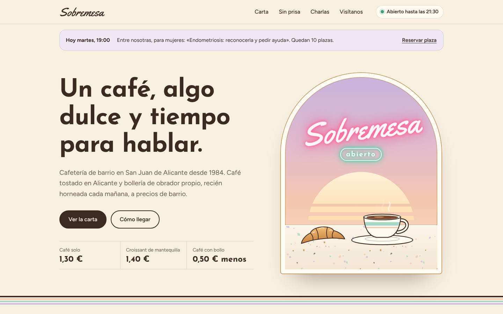
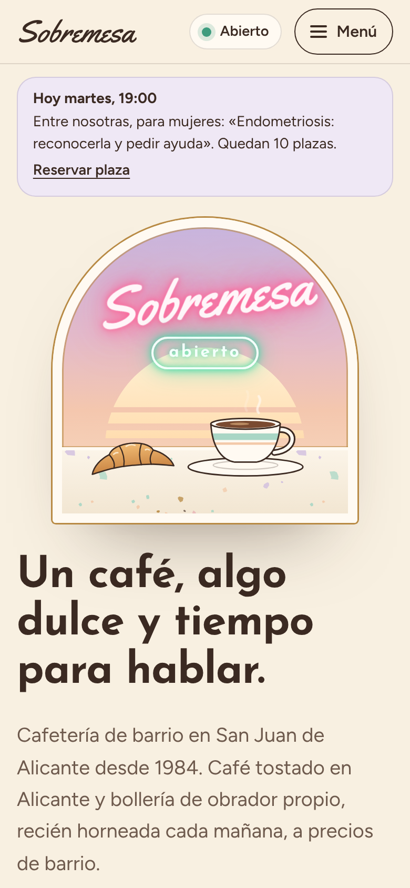

# Cafetería Sobremesa

<p align="center">
  
  
</p>

<p align="center"><strong><a href="https://nivorakk.github.io/Cafeter-a_Web/">Ver la web</a></strong></p>

Web de una cafetería ficticia en San Juan de Alicante, inspirada en las cafeterías españolas de los años 80: tonos nata y pastel, suelo de terrazo, rayas de la época y un letrero de neón que se enciende al entrar.

Todos los datos (nombre, dirección, teléfono, precios y ponentes) son inventados.

## Qué incluye

- **Portada.** Ventanal en arco con el neón de la cafetería. El rótulo «abierto» o «cerrado» y la etiqueta de la cabecera se calculan en directo con la hora de Madrid, esté donde esté quien visita la web.
- **Carta.** Cafés y bollería de obrador con precios de barrio. Las recetas exclusivas llevan la etiqueta «Solo aquí» y se pueden filtrar. Al tocar una bebida y un bollo aparece un ticket con el precio del desayuno y el descuento de 0,50 €.
- **Sin prisa.** La parte tranquila de la cafetería, con cartas de conversación para venir con amistades, con la familia o en pareja.
- **Charlas de salud** de 19:00 a 21:00:
  - **Martes, «Entre nosotras»:** para mujeres (menopausia, suelo pélvico, sueño, osteoporosis…).
  - **Jueves, «Entre nosotros»:** para hombres (próstata, corazón, estrés, apnea del sueño…).
  - Se muestran las próximas cuatro fechas con su tema y las plazas libres. La reserva se hace desde un formulario con validación y una pregunta anónima opcional. Sin política ni debates.
- **Visítanos.** Dirección, teléfono y horario, con el día de hoy resaltado.

## Cómo verla

No hace falta instalar nada. Abre `index.html` en el navegador o sírvela en local:

```bash
python3 -m http.server 8000
```

y entra en <http://localhost:8000>.

## Cómo cambiar el contenido

Precios, horario, temas de las charlas, ponentes y preguntas de conversación están en `assets/js/data.js`. Basta con editar ese archivo.

## Estructura

```
index.html
assets/
  css/styles.css     estilos (colores y tipografías al principio, en :root)
  js/data.js         contenido editable
  js/main.js         interacción
  img/terrazo.svg    textura de terrazo
  img/favicon.svg    icono
capturas/            capturas de la web e imagen de vista previa (vista-previa.png, 1280 × 640)
```

## Notas técnicas

- HTML, CSS y JavaScript sin dependencias. Las fuentes (Josefin Sans, Figtree y Yellowtail) se cargan desde Google Fonts.
- Funciona en móvil, se puede usar con teclado y respeta la opción del sistema de reducir animaciones.
- Las reservas son una demostración: se guardan solo en el navegador de quien reserva. Para usarlas de verdad hay que conectar el formulario a un correo o a un servicio de reservas.
